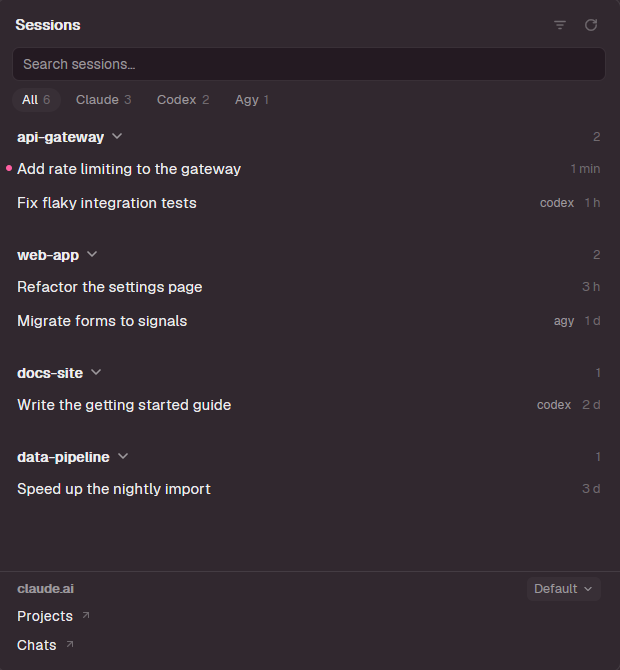

<div align="center">

<h1>herdr-sessions</h1>

[English](README.md)

[](LICENSE)
[](https://nodejs.org)

Un mod de [herdr](https://herdr.dev): un popup con todas las sesiones de Claude Code que has abierto, agrupadas por carpeta. Pulsas una tecla, buscas, haces clic y la sesión se reanuda en una pestaña nueva. No ocupa pantalla hasta que lo abres.



</div>

- **Agrupadas por carpeta** bajo títulos pequeños y atenuados, la más reciente primero, con el título y hace cuánto. La rama de git y el último prompt están en el tooltip. Los worktrees de git llevan etiqueta.
- **Plegar, añadir y organizar desde la cabecera**: cada carpeta tiene un chevron; al pasar el cursor por su cabecera aparecen un **+** (sesión nueva de Claude en esa carpeta) y un icono de ordenar (grupos por reciente o por nombre, o sin agrupar para una lista plana por fecha). Tu elección se recuerda.
- **Búsqueda** por título, último prompt, carpeta y rama.
- **Un clic la reanuda** (`claude --resume`) en una pestaña nueva, en la carpeta correcta.
- **Las sesiones en marcha se marcan** con un punto. Al pulsar una, salta a su pestaña en vez de abrir una segunda copia.
- **Enlaces de claude.ai**: fija tus propios Projects y Chats (copia el enlace y pulsa **+** en la cabecera "claude.ai"), además de los accesos a Projects y Chats. Se abren en el navegador y modo que elijas con el botón de esa cabecera, que siempre muestra la opción actual: predeterminado, Brave privado, Chrome incógnito, Edge InPrivate o Firefox privado. La elección se recuerda y empieza en "Default", así que elige la tuya una vez.
- **Un botón visible** en la barra superior, además de `Ctrl+Shift+S`, para no tener que recordar una tecla.
- **Popup o acoplado**: popup por defecto (`Ctrl+Shift+S`), así encaja en cualquier layout; también puede acoplarse como panel lateral.
- **Sigue tu tema**: solo usa los colores del layout activo.
- **Ligero por diseño**: un script de Node, sin dependencias, sin temporizadores y sin proceso en segundo plano. Lee al abrirse y al pulsar refrescar.

## Instalación

Requisitos: herdr-app (ábrela una vez), Node y Claude Code. Hecho y probado en Windows 11; macOS y Linux deberían funcionar pero no están probados.

**Lo más fácil:** pide a un agente de herdr que añada este repo como mod:

> Add the herdr-sessions mod from https://github.com/JhonZBM/herdr-sessions. Read RECIPE.md and every file before installing.

**A mano:** copia `mods/sessions/` (y `mods/sessions-button/`, opcional) en `~/.config/herdr-app/mods/` y compruébalo:

```sh
herdr-app check ~/.config/herdr-app/mods/sessions
```

Fusiona `mods/sessions/keys.json` en tu `keys.json` (asigna `Ctrl+Shift+S`), añade el botón de abajo, o ejecuta `herdr-app do mod.open '{"name":"sessions"}'`.

**Un botón visible (opcional):** `mods/sessions-button/` es un botoncito "Sessions" para la barra superior. Los layouts que trae herdr no se pueden editar, así que clona el tuyo (`layout.clone {"name":"main","as":"my-main"}`) y envuelve su bloque `tabs` en una fila con el botón. Usa la altura que ya tenga tu bloque `tabs` (30 px en `main`):

```json
{ "id": "tabbar", "type": "row", "size": { "px": 30 }, "window_drag": true,
  "children": [
    { "id": "sessions-button", "type": "block", "content": { "mod": "sessions-button" }, "size": { "px": 112 } },
    { "id": "tabs", "type": "block", "content": { "mod": "tabs" }, "size": { "weight": 1 } }
  ] }
```

**Panel acoplado (opcional):** añade un bloque a tu layout, justo después de la barra lateral, para tenerlo siempre visible:

```json
{ "id": "sessions", "type": "block", "content": { "mod": "sessions" }, "size": { "px": 300 }, "hidden": true }
```

Después `layout.toggle:sessions` lo muestra u oculta.

## Cómo funciona

Claude Code guarda cada conversación como una transcripción en `~/.claude/projects/<carpeta>/<id-de-sesión>.jsonl`. `index.js` lee solo los primeros 48 KB y los últimos 96 KB de cada archivo para sacar el título, el último prompt, la carpeta de trabajo y la rama, e imprime JSON. Nunca escribe, no envía nada por la red e ignora las transcripciones de subagentes.

## Límites

- Solo aparecen las sesiones guardadas en este equipo. Las sesiones en la nube y los Projects y Chats de claude.ai no están en disco y no hay API para leerlos, así que el panel solo abre sus enlaces; sigues necesitando haber iniciado sesión en claude.ai en ese navegador. Para trabajar un proyecto dentro de herdr, crea una carpeta local con su `CLAUDE.md` y sus archivos: sus sesiones aparecerán aquí solas.
- Una ventana privada del navegador comparte su sesión solo mientras haya una ventana privada abierta; si no, pedirá iniciar sesión otra vez.
- Saltar a una sesión en marcha busca su terminal por el nombre de la sesión que aparece en el título de la pestaña. Dos sesiones de Claude con el mismo nombre, o una que corra fuera de herdr, no se pueden emparejar y muestran "running outside herdr".
- Las sesiones sin título generado por la IA muestran su primer prompt.
- Por ahora solo es compatible con Claude Code.

## Contribuir

El código, los comentarios y los textos de la interfaz están en inglés. Los commits siguen [Conventional Commits](https://www.conventionalcommits.org/) (`feat:`, `fix:`, `docs:`, `refactor:`, `chore:`). Todo cambio debe pasar `herdr-app check` y quedar anotado en [CHANGELOG.md](CHANGELOG.md).

## Licencia

[MIT](LICENSE)
