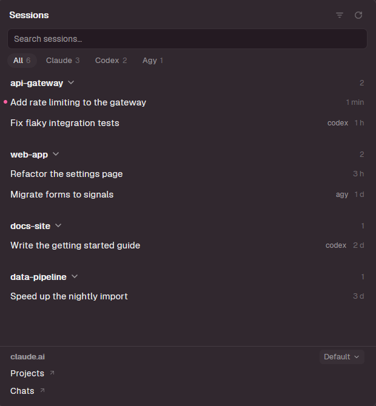

<div align="center">

<h1>herdr-sessions</h1>

[Español](README.es.md)

[](LICENSE)
[](https://nodejs.org)

A [herdr](https://herdr.dev) mod: a popup with every Claude Code session you have run, grouped by folder. Press a key, search, click, and the session resumes in a new tab. It takes no screen space until you open it.



</div>

- **Grouped by folder** under small muted headings, newest first, with the title and how long ago. The git branch and last prompt are in the tooltip. Git worktrees are tagged.
- **Search** across titles, last prompts, folders and branches.
- **One click resumes** the session (`claude --resume`) in a new tab, in the right folder.
- **Shortcuts to claude.ai** Projects and Chats, which live in the cloud and cannot be read locally.
- **Popup or docked**: a popup by default (`Ctrl+Shift+S`), so it fits any layout; it can also be docked as a side panel.
- **Follows your theme**: it only uses the active layout's colors.
- **Light by design**: one Node script, no dependencies, no timers and no background process. It reads on open and when you press refresh.

## Install

Requirements: herdr-app (open it once), Node and Claude Code. Built and tested on Windows 11; macOS and Linux should work but are untested.

**Easiest:** ask an agent in herdr to add this repo as a mod:

> Add the herdr-sessions mod from https://github.com/JhonZBM/herdr-sessions. Read RECIPE.md and every file before installing.

**Manually:** copy `mods/sessions/` into `~/.config/herdr-app/mods/` and check it:

```sh
herdr-app check ~/.config/herdr-app/mods/sessions
```

Merge `mods/sessions/keys.json` into your `keys.json` (it binds `Ctrl+Shift+S`), or run `herdr-app do mod.open '{"name":"sessions"}'`.

**Docked panel (optional):** add a block to your layout, right after the sidebar, to keep it always visible:

```json
{ "id": "sessions", "type": "block", "content": { "mod": "sessions" }, "size": { "px": 300 }, "hidden": true }
```

Then `layout.toggle:sessions` shows or hides it.

## How it works

Claude Code stores each conversation as a transcript in `~/.claude/projects/<folder>/<session-id>.jsonl`. `index.js` reads only the first 48 KB and the last 96 KB of each file to get the title, last prompt, working folder and branch, and prints JSON. It never writes, never sends anything over the network and ignores sub-agent transcripts.

## Limits

- Only sessions stored on this computer appear. Cloud sessions and claude.ai Projects are not on disk, so they are opened in the browser instead.
- Sessions without an AI-generated title show their first prompt.
- Only Claude Code is supported for now.

## Contributing

Code, comments and UI strings are in English. Commits follow [Conventional Commits](https://www.conventionalcommits.org/) (`feat:`, `fix:`, `docs:`, `refactor:`, `chore:`). Every change must pass `herdr-app check` and be recorded in [CHANGELOG.md](CHANGELOG.md).

## License

[MIT](LICENSE)
