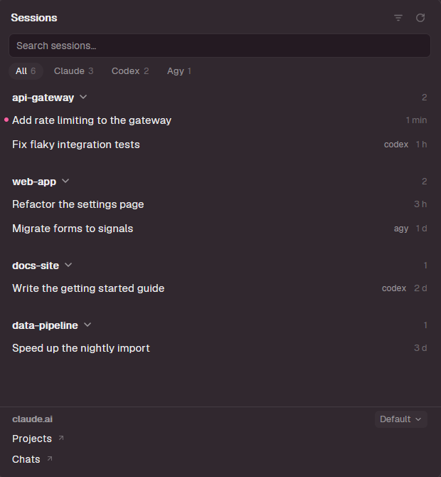

# Sessions

A popup for the herdr app that lists every Claude Code session on this computer, grouped by folder. Typing filters the list, a click resumes a session in a new tab, and two buttons open claude.ai Projects and Chats in the browser. The same view can be docked as a 300 px side panel.

## What you see

A popup opened at the top of the window (offset 48 px, 520 px wide, 75 % of the window height), fill `theme().popover`, base text 12 px. Docked, the same view fills a 300 px block with fill `surface`.

1. **Header**: "Sessions" (semibold, `foreground`) and a refresh icon button on the right.
2. **Search**: a 28 px input, placeholder "Search sessions…", border `border`, fill `background`, focused on open.
3. **List** (scrolls): for each folder a 24 px muted heading with no icon: the folder name (11 px semibold, `muted`), a "worktree" tag (`dim`) for git worktrees, a fold chevron (⌄ open, › closed) and the session count (10 px, `dim`) on the right. 16 px of space separate groups. Under it, one 28 px row per session: the title truncated (12.5 px, `foreground`) and its age on the right (10.5 px, `dim`: "now", "23 min", "6 d", then a date).
4. **Footer**: two 24 px buttons, "Projects ↗" and "Chats ↗".

Folders are ordered by their newest session; sessions inside a folder are newest first. Sessions without a generated title show their first prompt, or "(untitled)".

## How it behaves

- `Ctrl+Shift+S` (`mod.open:sessions`) opens the popup; pressing it again or Esc closes it. Opening a session closes it too.
- Click a folder heading: fold or unfold it. While searching, every folder with a match is shown unfolded.
- Click a session: `tab.new` with the session title as name, the session's folder as `folder` and `argv: ["claude", "--resume", <session id>]`.
- Hover a session: tooltip with the last prompt (110 characters) and the git branch. Hover shows `hover`, press shows `selected`.
- Refresh icon: reads the sessions again. Nothing else reads: no timers, no polling.
- "Projects" and "Chats" call `cx.open_url` with `https://claude.ai/projects` and `https://claude.ai/recents`.
- Errors reading the sessions show "Could not read: <message>" in the list.

## Built from

- `mods/sessions/mod.json`: `{ "place": "none", "title": "Sessions", "overlay": { "kind": "popup", "at": "top", "offset": 48, "width": 520, "height": 0.75 } }`.
- `mods/sessions/keys.json`: `{ "global": { "ctrl-shift-s": "mod.open:sessions" } }`, to merge into the person's keys.
- `mods/sessions/main.js`: a `View` using `gpui-kit` and `gpui-base` (`v_flex`, `h_flex`, `InputState`, `Input`, `overflow_y_scrollbar`), and from `herdr`: `exec`, `home`, `run`, `theme`, `props`, `closeOverlay`. `props()?.overlay` (`props()` can be null) tells the popup from a docked block: the popup uses a fixed 520 px height, `popover` fill, focuses the search and closes itself when a session opens. All colors come from `theme()`.
- `mods/sessions/index.js`: plain Node, no dependencies. Run with `exec("node", [<home>/.config/herdr-app/mods/sessions/index.js])`. For every `~/.claude/projects/<folder>/*.jsonl` it reads the first 48 KB and the last 96 KB, parses each complete JSON line and takes `cwd`, `gitBranch`, the last `ai-title`, `last-prompt` and `agent-name`. It prints a JSON array of `{id, cwd, project, worktree, title, name, last, branch, mtime}` sorted by `mtime` descending. Transcripts without a `cwd` are skipped. A path containing `.claude/worktrees` marks a worktree.
- Icons (`refresh.svg`, `external.svg`): one-color SVGs tinted by the text color.
- Optional docked mode: a layout block `{ "id": "sessions", "type": "block", "content": { "mod": "sessions" }, "size": { "px": 300 }, "hidden": true }` right after the sidebar, shown with `layout.toggle:sessions`.

## Watch out

- The popup's height is set in the view (`.h(520)`); `mod.json` alone did not apply it. Keep both in step.
- When docking, a layout that already holds a `sessions` block gets no second one from `place`; renaming the mod makes herdr add another block, so remove the duplicate.
- Only local sessions exist on disk. claude.ai Projects, scheduled tasks and cloud sessions cannot be listed, which is why those are links.
- Reading 100+ MB of transcripts whole would be slow; keep the head and tail limits.
- The script needs `node` on the PATH; `exec` runs it for real, including during `herdr-app check`.

## Done when

- `herdr-app check ~/.config/herdr-app/mods/sessions` passes and no `*.error` file appears.
- The popup lists the folders that have sessions in `~/.claude/projects`, newest first.
- Typing a word that appears in a title or folder name filters the list.
- Clicking a session opens a tab whose terminal runs `claude --resume <id>` in the session's folder.
- `Ctrl+Shift+S` opens and closes the popup.
- "Projects ↗" opens `https://claude.ai/projects` in the browser.
- With the popup closed, no process runs and nothing is read.
